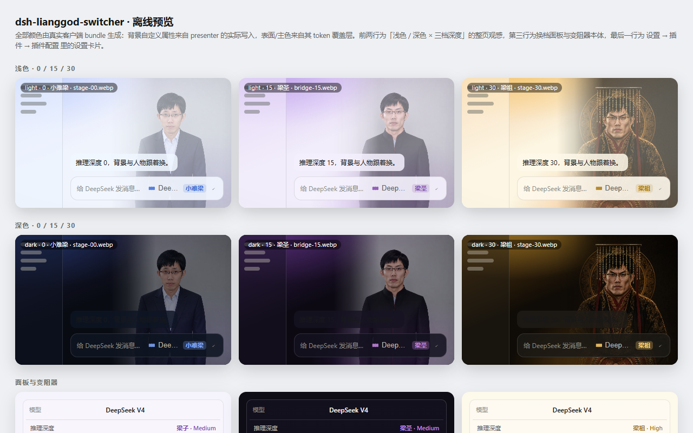
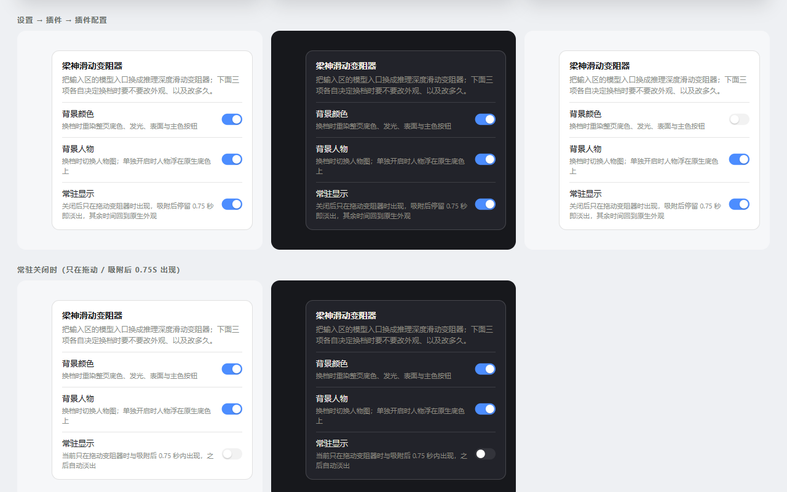

# dsh-lianggod-switcher · 梁神 Rheostat

[中文](README.md) | **English**

Replaces the model selector in the DeepSeek Harness (DSH) web composer with an **infinite (stepless) reasoning-depth rheostat**: dragging keeps the background and the portrait glued to the thumb and walks the whole appearance ladder in order, and **only the release snaps** onto the nearest available reasoning depth and commits it. Which parts of that appearance exist — and when they are visible — is owned by three switches in **Settings → Plugins → Plugin configuration**.

Zero runtime dependencies: the plugin is `index.js` + `host.js` plus 24 WEBP anchors.





You do not have to install anything to see it: [`preview.html`](preview.html) in the repository root is a generated static preview (light/dark × three depths, the rheostat itself, the settings card) — just open it. It is regenerated from the real `index.js` by `npm run preview`, and the two screenshots above are its captures.

Inspiration:

- [lemonorangeapple/dsh-effort-switcher](https://github.com/lemonorangeapple/dsh-effort-switcher) — the reasoning-effort slider and the `conversation.input.model` seat takeover.
- [kingOfSoySauce/dsh-liang-skin](https://github.com/kingOfSoySauce/dsh-liang-skin) — the depth-driven background/portrait feel, the 0–30 depth axis and the 小难梁 → 梁祖 rank names.

## Features

| Capability | Detail |
|---|---|
| **Stepless rheostat** | The thumb is continuous (input range 0–1000, `step=1`): it tracks the pointer 1:1 and the background/portrait flow with it instead of jumping one notch at a time. Tick marks only mark the available depths |
| **Snap on release only** | While dragging nothing is written and nothing snaps. Release (or keyboard confirm / blur) snaps to the nearest depth: the thumb springs onto it and the background stays there. Releasing on the depth already committed writes nothing — the background is just put back |
| Drag feedback | The **committed** depth is marked with a bold white dot and the thumb ring highlights while dragging; no "preview mode" caption appears |
| Keyboard | ←/→/↑/↓ move one whole depth (not 1/1000 of the track), Home/End jump to either end, Esc abandons the drag without writing |
| Depth axis | Any N depths spread evenly over 0–30 (2 → 0/30, 3 → 0/15/30, 5 → 0/7.5/15/22.5/30) |
| Rank names | 小难梁 / 牢梁 / 梁子 / 梁圣 / 梁神 / 梁祖, interpolated continuously, shown next to the model's own depth name |
| Background | The palette flows with the depth while dragging; one radial flare plays on commit; six colour stops (ice blue → indigo → violet → magenta → orange → gold) |
| Portrait | 24 depth anchors (`stage-00 … stage-30`) on the same 0–30 axis, switched with an **overlapping cross-fade** (the incoming image fades in over 240ms while the outgoing one fades out over 380ms, so the frame is never empty), growing in width and opacity with the depth; a left-edge mask keeps it out of the conversation column |
| Surface tint | `ctx.theme.overrideTokens` recolours `bg-base` / `bg-layer-1..3` / sidebar / composer / bubbles / brand colour, so the backdrop shows through and primary buttons follow the depth |
| Model switching | The full model list stays in the popover — the plugin owns the native seat, so removing it would remove model switching |
| Three switches | 背景颜色 / 背景人物 / 常驻显示 all live in **Settings → Plugins → Plugin configuration**; the depth popover contains no switches |

Models without reasoning effort, or with a single depth, do not render the slider (the seat still offers model switching). Addressed subagent sessions do not render the seat.

## Settings

Entry point: **Settings → Plugins → Plugin configuration → 梁神滑动变阻器** (the same page as the Bash timeout and web-search cards).

| Switch | Default | Effect |
|---|---|---|
| 背景颜色 (background colour) | on | Recolours the page canvas, both glows, layered surfaces, sidebar, composer, bubbles and primary buttons per depth. Off returns the UI to your own theme |
| 背景人物 (portrait) | on | Cross-fades the portrait to the nearest anchor and grows it with the depth. **With only this on**, the page keeps its native canvas colour (the plugin opens the canvas but recolours nothing) and the portrait floats on it |
| 常驻显示 (always visible) | on | On: background and portrait stay on screen permanently (subject to the two switches above). Off: they appear **only while the rheostat is held**, stay for **750ms** after the snap, fade out over 320ms, and then the page is fully native again — the layer is not even in the DOM |

With the first two off the plugin paints nothing at all (only the rheostat control remains) and depths are still committed to the model. 常驻显示 only decides **when** the appearance shows, not **what** it shows.

- Values live in the host settings document (the `lianggod-switcher:` section of `<DSH_HOME>/settings.yaml`), per profile and shared across browsers; they survive reloads and restarts.
- When the GUI is opened through a non-loopback address (LAN, tunnel) DSH keeps settings writes in process memory (only loopback connections are treated as writable), so the switches are **readable but not persistable** there. That is the host settings transport, not this plugin's choice.
- Without a settings provider (e.g. only the client half installed) the three switches default to on and the card does not appear in the settings page.
- Defaults can also be pinned in the plugin's `cordis.patch.yml` row — that becomes the settings `base` layer, which the user document then overrides:

  ```yaml
  - id: lianggod-switcher
    name: dsh-lianggod-switcher
    config:
      portrait: false
  ```

## Install

Run this inside the plugin repository (`<path to this repo>` is the checkout path):

```sh
dsh plugin --profile web add <path to this repo>
# once published to GitHub: dsh plugin --profile web add github:<user>/dsh-lianggod-switcher
```

Then **fully restart** `dsh web` (client bundles are only scanned into the boot graph at startup) and refresh `http://127.0.0.1:3080`.

No manual edit of the profile's `cordis.patch.yml` is needed: `dsh.bundle.patch` in `package.json` inserts the loader row.

`index.js` is pure client code, so a change there only needs a page refresh — the bundle route reads from disk on every request. Changes to `host.js` (static routes / settings schema) need a process restart.

Verify:

```sh
dsh --profile web --dump-config | grep lianggod-switcher
npm test        # client + host self-checks
```

Uninstall:

```sh
dsh plugin --profile web remove dsh-lianggod-switcher
```

## Compatibility

- Developed and tested against **DSH `0.1.0-rc.7`**, web profile.
- Host contracts used: the `conversation.input.model` single slot (lowest `priority` renders), `modelDirectories.directoryFor(sessionId)`, `ctx.theme.overrideTokens`, `ctx.webServer.register` (`exact` routes), `ctx.settings.register` plus the browser's `ctx.settingsScope.bind`, and `settings.plugin.item` (keyed, dispatched by the namespaces the host actually serves). Check those first when the host version moves.

## Implementation notes

- **The host half is not just a mount point** (`host.js`): `dsh.client` can expose exactly one script (the bundle), while binary assets need real HTTP routes. The host registers all 24 portraits with `ctx.webServer.register({ kind: "exact", path })` (`/plugins/dsh-lianggod-switcher/assets/portrait/*.webp`, with ETag, `304`, and streams destroyed when the plugin unloads).
- **Nearest decoded anchor**: 24 anchors are laid out on the 0–30 axis (2/5/8/11/20/23/26 have no frame of their own); the nearest **decoded** anchor wins, falling back to the next nearest on failure.
- **The cross-fade overlaps, it does not take turns**: one tick sets `data-leaving="1" + data-active="0"` on the outgoing frame and `data-active="1"` on the incoming one; the outgoing transition is stretched to 380ms while the incoming runs 240ms ease-out, so the two opacity curves overlap for 240ms and the frame is never blank. `img.decode()` runs first so the incoming frame has pixels before its opacity moves, and `onload` carries a generation token so only the last swap of a fast drag wins.
- **Seat takeover**: `slots.register({ name: "conversation.input.model", priority: -100, inject: (sessionId) => … })` — the lowest `priority` wins a single slot, so the native model selector is not rendered at all.
- **The settings card uses the official seat**: the 插件配置 tab (`settings.plugin.item`, keyed) only dispatches **namespaces the host actually serves**. That is why the host half registers `settings.register("lianggod-switcher", schema)` inside `ctx.inject(["settings"], …)`, and why the client binds the same namespace through `settingsScope.bind({ namespace })` and uses the same string as the card's `key`.
- **The schema is hand-written**: `settings.register` only calls the schema (validate + fill defaults) and reads its `toJSON()`. `@deepseek-ai/schemastery` lives inside the profile/deployment, so a plugin installed from the user directory cannot import it, and vendoring a second copy would shadow the shared instance. `host.js` therefore ships an equivalent implementation whose `toJSON()` reproduces Schemastery's `{ uid, refs }` envelope, and the client binds with its own `decode`, so it never depends on envelope fidelity.
- **Commit semantics**: `directory.select({ provider, model, reasoningEffort })` counts as failed only when it rejects or resolves `{ ok: false }`; a release that arrives while a write is in flight is queued, never dropped.
- **How stepless works**: the `<input type=range>` spans `0..1000 step=1`, and `t = value/1000` feeds the palette interpolation and portrait anchor selection directly, so everything is continuous during the drag. On release `nearest = round(t × (N−1))` picks the depth to commit, then `dragStep` resets to −1 so the thumb returns to the controlled "settled" value — the CSS transition turns that return into the visible magnetic snap. Transitions are **disabled while dragging** (`[data-dragging="1"]`), otherwise the thumb lags behind the pointer.
- **Persistent vs transient is one visibility gate**: the presenter holds `revealed` + `draggingNow`, and with `persistent: false` `live()` additionally requires `revealed`. Press → `setDragging(true)` → `reveal()`; release → `setDragging(false)` → **750ms** later the layer gets `data-on="0"` (320ms fade), then it is really unmounted and the token layer removed, returning the page to its native look. Timers hang off `document.defaultView` and `dispose()` cancels them.
- **The backdrop really is *under* `body`**: the host paints `body{background:var(--dsw-alias-bg-base)}` and `.frame{background:var(--dsw-alias-bg-base)}`, so the plugin overrides that token to `transparent` and prepends a `position:fixed; z-index:-1` layer to `<body>` — body is not a stacking context, so the negative z lands above the transparent canvas and below every positioned panel.
- **Reversible**: the layer, `html[data-dsh-lianggod-background]`, fifteen body custom properties, the token layer and the settings subscription are all retracted by the same fiber disposer; turning all three switches off or uninstalling leaves nothing behind.
- **Performance**: dragging only writes body custom properties (batched on rAF) and never publishes `theme/change`; the token layer is re-published only when a depth is committed, avoiding a full-tree re-render.

## Development

```sh
npm test        # test/verify-client.cjs (micro DOM, a hook runtime that renders the real
                # component, and controllable timers) + test/verify-host.cjs (a real http
                # server driving the static routes, settings namespace and schema)
npm run check   # syntax check of both halves
npm run preview # regenerate preview.html from the real index.js
```

Layout:

```text
index.js             browser half: rheostat seat + background/portrait presenter + settings card
host.js              host half: settings namespace lianggod-switcher + portrait static routes
cordis.patch.yml     bundle patch: inserts the loader row with id lianggod-switcher
package.json         exports["./client"], dsh.bundle and dsh.client metadata
assets/portrait/     24 portrait anchors (stage-00.webp … stage-30.webp, ~1.3 MB)
test/                the two headless self-checks
scripts/             the offline preview generator
preview.html         generated static preview (open it directly)
THIRD_PARTY_NOTICES.md  portrait asset provenance and licensing
```

## Third-party assets

`assets/portrait/*.webp` come from [kingOfSoySauce/dsh-liang-skin](https://github.com/kingOfSoySauce/dsh-liang-skin) (which credits [Lichtspektrum/liang-intensity-calibrator](https://github.com/Lichtspektrum/liang-intensity-calibrator) for the concept and the artwork) and are **not covered by this repository's MIT license**. See [`THIRD_PARTY_NOTICES.md`](THIRD_PARTY_NOTICES.md); replacement/removal steps are in [`assets/portrait/README.md`](assets/portrait/README.md). Removing the portraits does not break the plugin — it degrades to colour-only.

## Known limitations

- Turning `--dsw-alias-bg-base` transparent also turns `meta[theme-color]` transparent (browser chrome tint), and the code-block sticky banner plus the boot splash show the backdrop — the same trade-off the reference skin makes.
- The portrait always covers roughly 42–54vw on the right edge (widening with depth); another decorative widget on the same side will overlap it.
- The three switches are host settings, so a GUI opened through a non-loopback address can read but not persist them (the host treats non-loopback connections as in-memory).
- With another skin plugin enabled, the token layer registered last wins; do not run two skins if you are unsure which one wins.
- The plugin writes no session log and adds no model-visible input, so it cannot affect the KV cache and needs no `SessionEventMap` event.

## License

Code is released under [MIT](LICENSE). The portrait assets are excluded — see [`THIRD_PARTY_NOTICES.md`](THIRD_PARTY_NOTICES.md).
